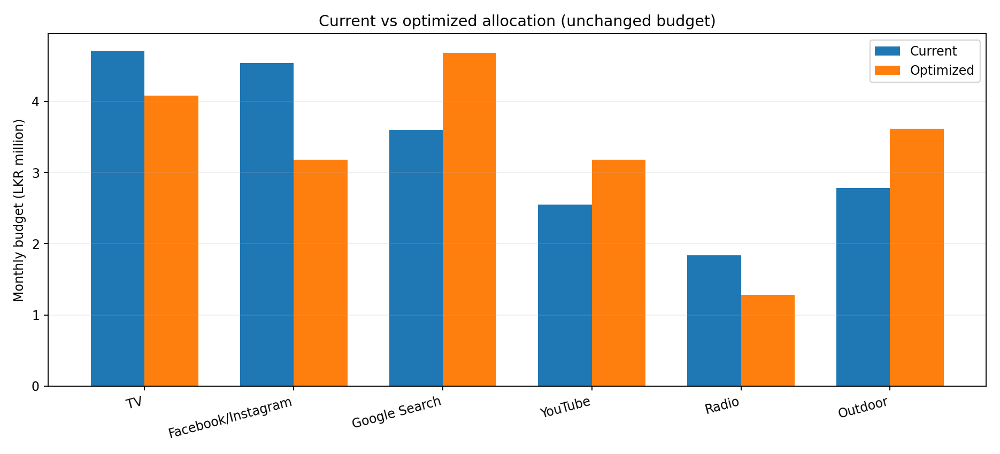
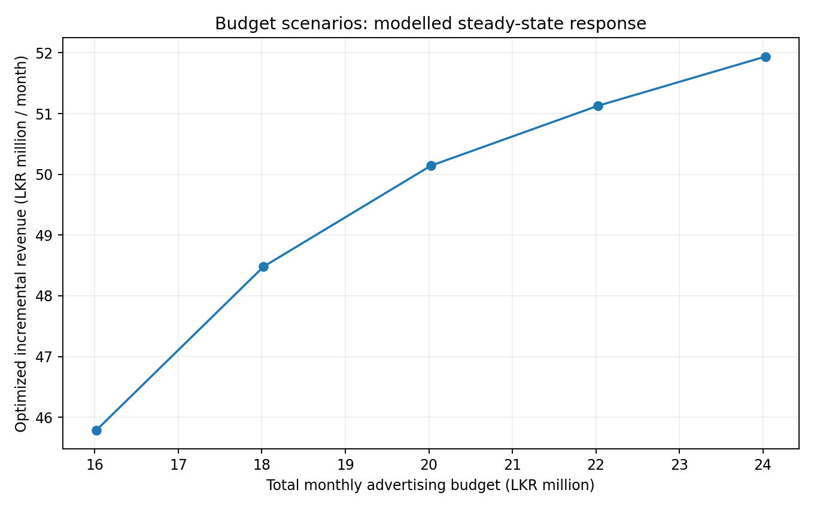
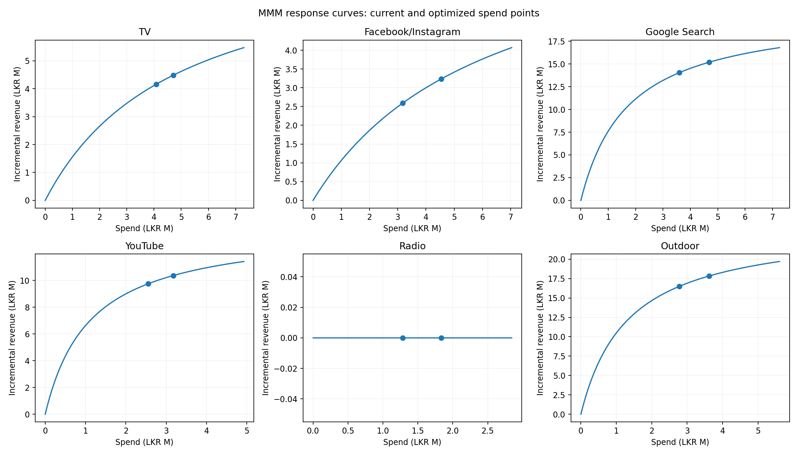

# Team 4 — Budget Optimisation Report

**Source model:** `models/mmm/final_mmm.json`, used via `src/mmm_response.py`.  
**Historical data:** `data/processed/mmm_analysis_ready.csv` (January 2023–December 2025; 36 observations).  
**Code:** `src/budget_optimization.py` and `notebooks/10_budget_optimization.ipynb`.  
**Currency and frequency:** LKR per month.

## 1. Executive summary

Using the existing MMM response functions, we reallocated the **2025 average monthly advertising budget** across TV, Facebook/Instagram, Google Search, YouTube, Radio and Outdoor. We held total spend constant, added feasible min/max constraints, and maximized the MMM-estimated *incremental monthly revenue*.

| Fixed-budget performance indicator | Current allocation | Optimized allocation |
|---|---:|---:|
| Total advertising spend (LKR million/month) | 20.024 | 20.024 |
| MMM-estimated incremental revenue (LKR million/month) | 48.027 | 50.143 |
| Model-estimated portfolio ROAS | 2.398x | 2.504x |

**Predicted improvement:** **LKR 2.116 million / month (+4.41%)** in *steady-state incremental revenue*, at the **same total advertising budget**. This is a simulation using the trained model, **not an observed causal improvement or guaranteed future sales forecast**.

## 2. Problem formulation

The existing `ResponseModel` exposes a Hill saturation revenue-response curve per channel:

\[
R_i(x_i)=\beta_i\frac{(x_i/s_i)^{\alpha_i}}{(x_i/s_i)^{\alpha_i}+K_i^{\alpha_i}}
\]

Here, `x_i` is monthly advertising spend in LKR, `s_i` is the calibrated channel scale, `K_i` the half-saturation factor, and `beta_i` the channel coefficient. The final model fixes the Hill exponent at `alpha_i=1` and has non-negative media coefficients. Normalized adstock from the fitted MMM describes carryover; the optimization curves assume channel spending is held constant long enough to reach its steady state.

We maximize total incremental modeled revenue:

\[
\max_{x_1,\dots,x_6}\sum_{i=1}^{6}R_i(x_i)
\]

subject to `sum(x_i) = B` and `L_i <= x_i <= U_i`, where `B = LKR 20,023,825` per month. Under a fixed budget, maximizing incremental revenue is mathematically equivalent to maximizing modeled ROAS. We do **not** calculate a profit-based ROI because no reliable channel contribution margins or costs were supplied.

We solve the problem using **SciPy SLSQP** and an analytic gradient, with optimization variables scaled to LKR millions for numerical stability. Since the fitted Hill exponent is one and channel coefficients are nonnegative, the revenue objective is concave; model-estimation and attribution risks remain regardless of mathematical convergence.

## 3. Spend constraints and assumptions

This implementation uses **illustrative bounds**: each channel may vary from **70% to 130% of its 2025 monthly average**, but must also stay within its **observed 2023–2025 historical monthly spending range**. These constraints prevent unrealistic zero spends and reduce extrapolation. They are not verified business commitments and should be reviewed against contracts, minimum brand coverage and actual campaign capacity.

## 4. Current vs optimized budgets

| Channel | Current spend (LKR m) | Optimized spend (LKR m) | Change | Current marginal ROAS | Optimized marginal ROAS |
|---|---:|---:|---:|---:|---:|
| TV | 4.711 | 4.084 | -13.3% | 0.48 | 0.55 |
| Facebook/Instagram | 4.541 | 3.178 | -30.0% | 0.41 | 0.54 |
| Google Search | 3.601 | 4.682 | +30.0% | 1.27 | 0.88 |
| YouTube | 2.553 | 3.178 | +24.5% | 1.16 | 0.84 |
| Radio | 1.834 | 1.284 | -30.0% | 0.00 | 0.00 |
| Outdoor | 2.782 | 3.617 | +30.0% | 1.91 | 1.32 |

**Interpretation:** within these bounds, the fitted MMM favors increasing Outdoor, Google Search and YouTube, while reducing TV, Facebook/Instagram and Radio. Marginal returns are not necessarily equal at a constrained optimum because channels can be bound by their minimum or maximum spends. The Radio channel's fitted coefficient is zero, but **that does not establish zero causal effectiveness**.

## 5. Overall budget scenarios

| Budget multiplier | Total monthly budget (LKR m) | Optimized incremental revenue (LKR m) | Modelled portfolio ROAS | Revenue change vs original allocation |
|---|---:|---:|---:|---:|
| 0.8x | 16.019 | 45.788 | 2.858x | -4.66% |
| 0.9x | 18.021 | 48.482 | 2.690x | +0.95% |
| 1.0x | 20.024 | 50.143 | 2.504x | +4.41% |
| 1.1x | 22.026 | 51.130 | 2.321x | +6.46% |
| 1.2x | 24.029 | 51.939 | 2.162x | +8.15% |

The 1.0x row isolates *reallocation at constant total spend*. In the other rows, differences combine a change in total budget and allocation. Diminishing returns reduce estimated ROAS as spend rises.

## 6. Robustness and constraint sensitivity

| Spending flexibility (also capped to observed range) | Predicted uplift, fixed budget |
|---|---:|
| Conservative: 85–115% of current | +2.61% |
| Moderate: 70–130% of current | +4.41% |
| Flexible: 60–150% of current | +4.82% |

A train-only MMM fit is also evaluated as a sensitivity check. Under the same moderate bounds and 2025-average baseline, it estimates roughly **+4.88%** uplift from its own optimized allocation. These checks are not confidence intervals: they share observational data and similar assumptions.

## 7. Figures







## 8. Output files and interactive Power BI hand-off

Import the exported CSVs using **Power BI Desktop > Get Data > Text/CSV**:

- `outputs/budget_optimization/optimization_summary.csv`: KPI cards for baseline revenue, optimized revenue, uplift and portfolio ROAS.
- `outputs/budget_optimization/channel_allocation_comparison.csv`: grouped bar chart of current vs optimized budget; marginal ROAS comparison.
- `outputs/budget_optimization/budget_scenarios.csv`: total budget vs predicted revenue/ROAS line charts.
- `outputs/budget_optimization/scenario_channel_allocations.csv`: slice allocation by budget multiplier (0.8x, 0.9x, 1.0x, 1.1x, 1.2x).
- `outputs/budget_optimization/channel_bounds.csv`: display and explain constraints.
- `outputs/budget_optimization/constraint_sensitivity.csv`: estimated lift under different spending-flexibility policies.
- `outputs/budget_optimization/model_sensitivity.csv`: train-only vs full-refit model check.

**Amounts in the CSVs are raw LKR**, not LKR millions. Divide by 1,000,000 for a dashboard axis in millions.

## 9. Recommendations and limitations

1. **Pilot, do not immediately deploy.** Test modest shifts toward Outdoor, Google Search and YouTube while monitoring actual incremental sales and delivery capacity.
2. **Confirm channel minimums and maximums** with stakeholders before committing to the numerical allocation. The initial constraint policy is illustrative.
3. **Coordinate ROI language with Team 3**: modelled incremental revenue / spend is a ROAS-style metric; true profit ROI requires margin and cost information.
4. **Respect adstock delays and external factors.** Predictions describe a sustained-spending steady state, not the first month after reallocating spend. Promotions, economic conditions and other controls are implicitly held fixed during comparisons.
5. **Clearly discuss uncertainty.** Only 36 monthly observations inform the MMM; media spend can be correlated and channel rankings may depend on model choice. A zero fitted coefficient does not establish the absence of causal effect. The final model was refitted on all available historical months after time-aware holdout evaluation; the proposed budget shift has **not** been externally validated.

## 10. Reproducibility

From the repository root:

```bash
python -m pip install numpy pandas scipy matplotlib pytest notebook
python -m src.budget_optimization
python -m pytest tests/test_budget_optimization.py -v
jupyter notebook notebooks/10_budget_optimization.ipynb
```

The existing Part 1 and Part 2 code was left unchanged. For the model inputs used to run the optimizer, see `models/mmm/final_mmm.json` and `src/mmm_response.py`.
