# Exploratory Data Analysis

Full analysis with code and outputs: `notebooks/04_eda.ipynb`. Figures: `reports/figures/`.

The sample is small (36 months), so a correlation must exceed about 0.33 in absolute value to be significant at 5%. The relationships are associations, not proof of cause, and the data is synthetic.

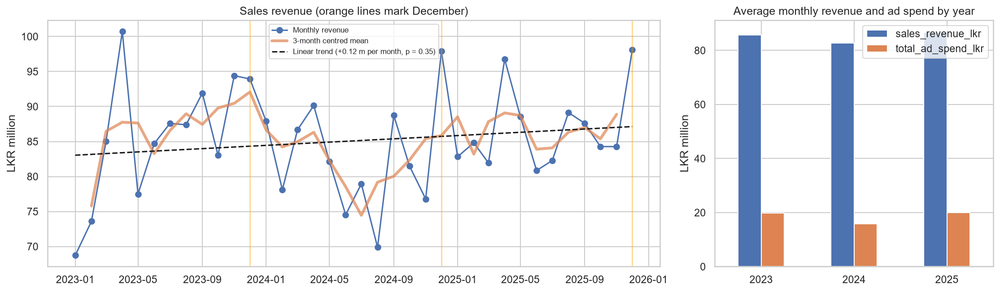
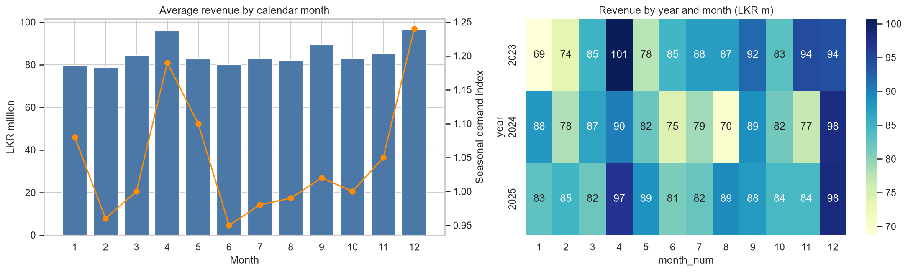
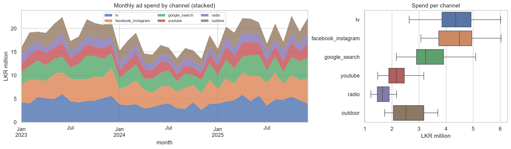
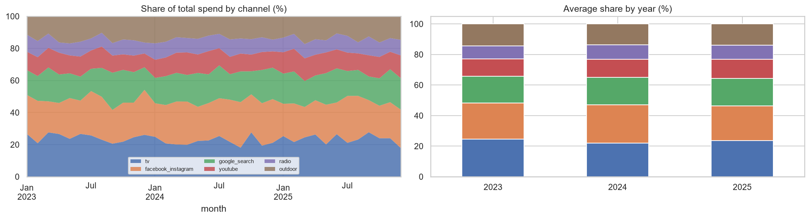
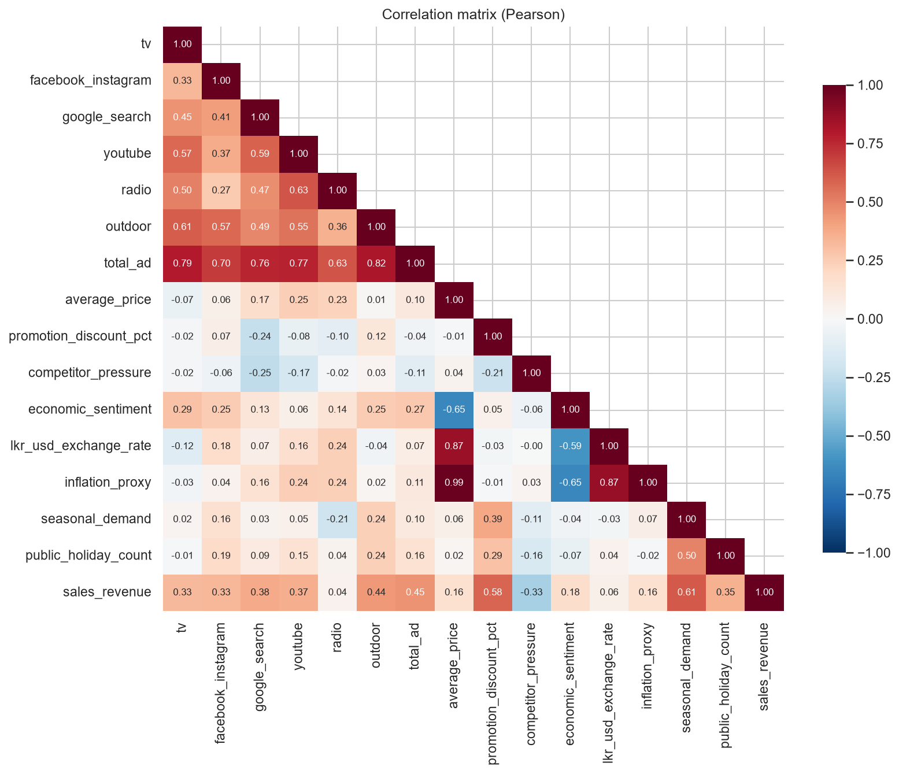
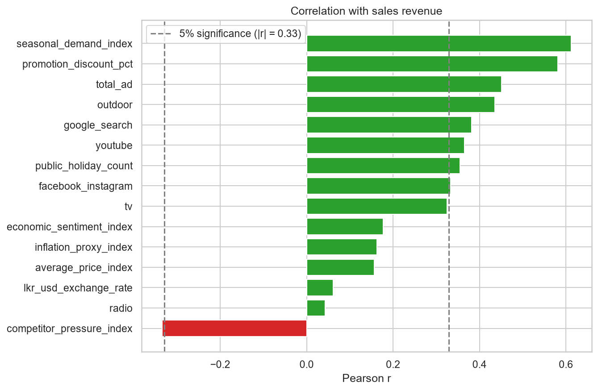
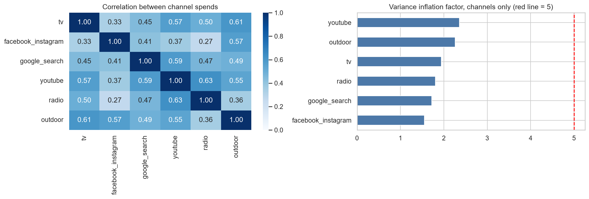
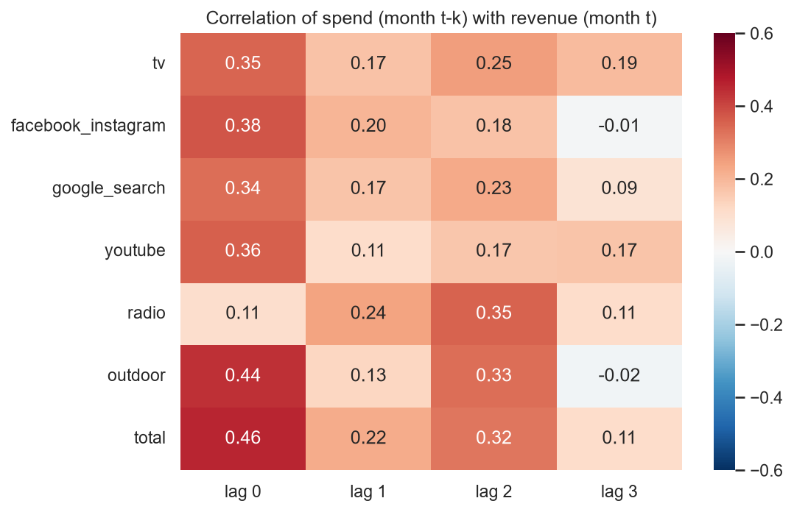
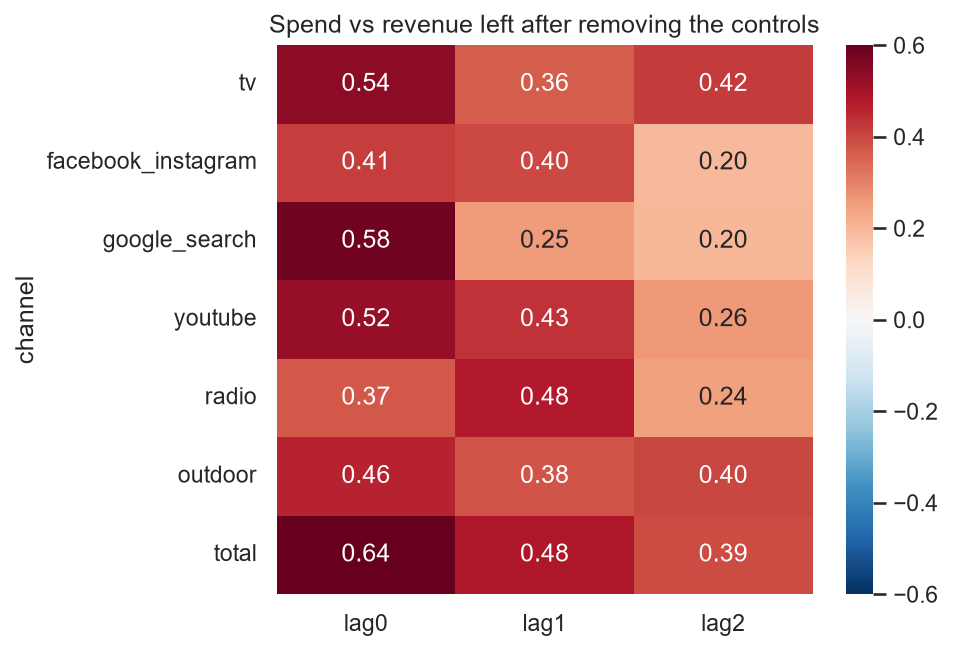
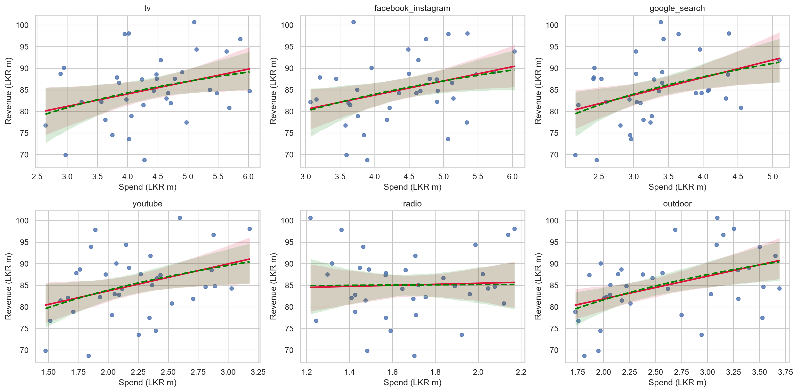
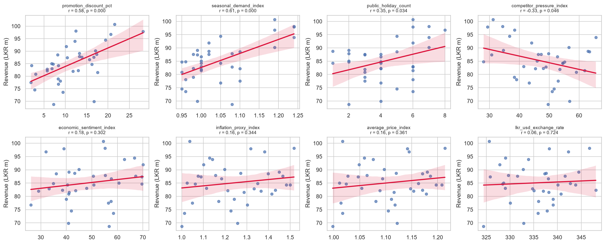
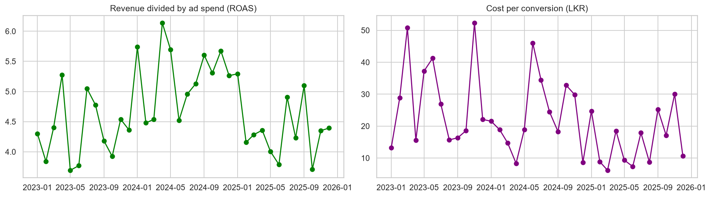

## Summary of findings

1. Sales. Monthly revenue averages LKR 85.1 m (SD 7.6 m, range 68.7 m to 100.7 m). There is no significant trend (+0.12 m per month, R2 = 0.03, p = 0.35). Yearly averages are 85.7 m (2023), 82.8 m (2024) and 86.8 m (2025). Revenue is highest in December (96.7 m on average) and April (95.9 m), followed by September (89.4 m).
2. Spend. Total spend averages LKR 18.6 m a month. Yearly totals are 238.1 m (2023), 190.3 m (2024) and 240.3 m (2025), so spend fell in 2024 and recovered in 2025. Facebook/Instagram (23.7%) and TV (23.5%) take the largest shares, radio (9.0%) the smallest. The mix is almost the same every year, which limits how well channel effects can be separated. No channel has outliers.
3. Correlation with revenue (n = 36, significant above about 0.33). Seasonal demand index 0.61 and promotion discount 0.58 are the strongest. Total ad spend is 0.45, outdoor 0.44, Google Search 0.38, YouTube 0.37, public holidays 0.36 and Facebook/Instagram 0.33 (p = 0.047). TV is 0.325 (p = 0.053) and radio 0.04. Competitor pressure is the only negative one (-0.335). Price, inflation, exchange rate and economic sentiment are not significant (0.06 to 0.18). Promotion and seasonality are almost uncorrelated with spend, so they are not strongly mixed up with advertising.
4. Collinearity. Correlation between channel spends ranges from 0.27 to 0.63 and the variance inflation factors are 1.6 to 2.4, which is acceptable. The trend variables are the problem: `inflation_proxy_index`, `average_price_index` and the month counter correlate 0.99 to 1.00, and the exchange rate correlates 0.87 with them. Only one of these should go into a model.
5. Delayed effect. For every channel except radio the correlation is highest in the same month. Radio is highest at a lag of 2 months. After removing the part of revenue explained by seasonality, promotion, holidays and competitor pressure (together R2 = 0.55), every channel still has a positive correlation with the remainder at lags 0 to 2 (0.37 to 0.58 at lag 0, total spend 0.64). Radio is highest at lag 1 (0.48). This fits a carry-over effect, but with 36 months and spend that moves slowly, the lags cannot be separated reliably. The decay rate should be estimated in the model.
6. Diminishing returns. A log fit is better than a linear fit only for Google Search, YouTube and outdoor, and by at most 0.02 in R2. Spend varies within a narrow range (coefficient of variation 16% to 24%), so saturation curves cannot be read from these plots and have to be estimated in the model.
7. Promotions and holidays. Months with a promotion of at least 15% (11 months) had 6.8% higher revenue than other months (p = 0.074). Months with at least 6 public holidays (12 months) had 7.1% higher revenue (p = 0.055). Both differences are suggestive, not conclusive.
8. Funnel. Average click-through rate is 2.25%, conversion rate 3.65%, cost per click 0.72 LKR, cost per conversion 22.2 LKR and revenue per rupee of ad spend 4.66 (range 3.69 to 6.14). Impressions (0.07) and clicks (0.05) are almost unrelated to revenue and conversions are weak (0.29). These figures describe the funnel but should not be model inputs.

## Recommendations for modelling

* Include seasonality, promotion, holiday and competitor variables next to the media variables. Together they explain more of revenue than any single channel.
* Use only one of `inflation_proxy_index`, `average_price_index` and the time counter.
* Leave out `impressions`, `clicks`, `conversions`, `total_ad_spend_lkr` and any column built from revenue (see the modelling_role column in `reports/data_dictionary.md`).
* Estimate adstock and saturation inside the model. The helpers `geometric_adstock` and `hill_saturation` are in `src/preprocessing.py`.
* With 36 rows, use regularisation or priors and validate with the walk-forward folds from notebook 05. Keep the last 6 months for the final test.
